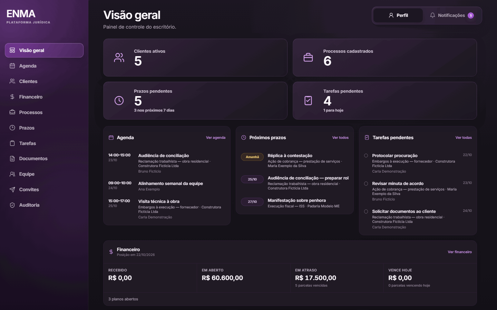
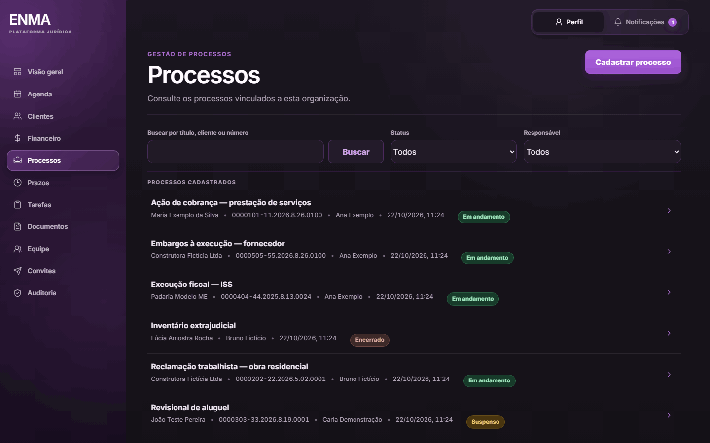
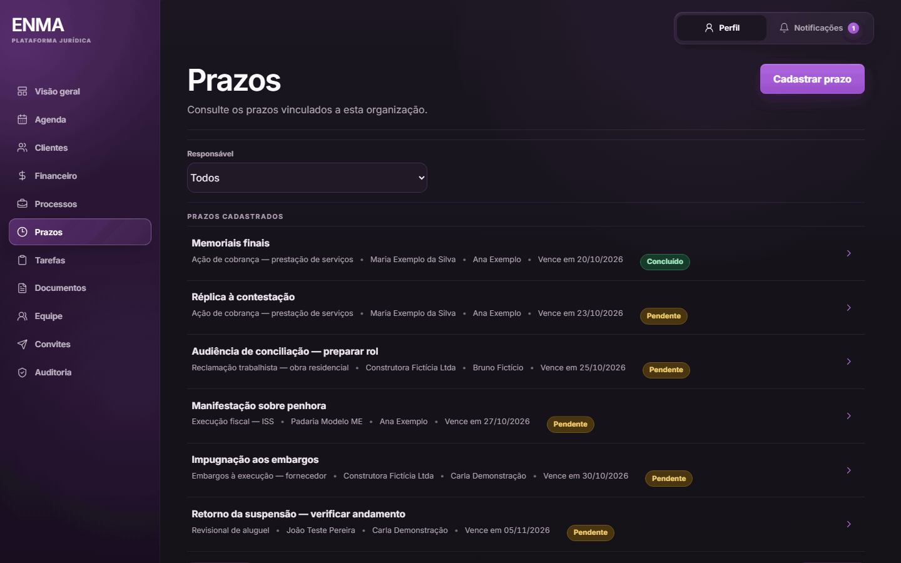
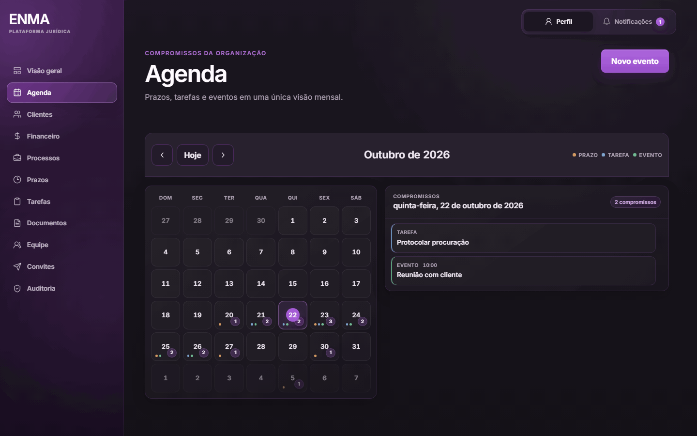
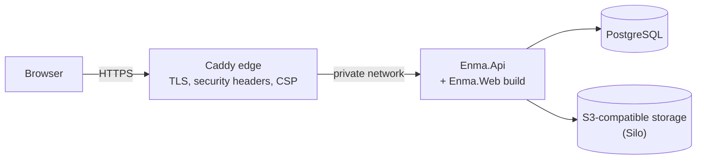

# ENMA

Multi-tenant SaaS for managing Brazilian law firms: clients, legal processes,
deadlines, tasks, agenda, documents and billing in one workspace per firm.

**Status:** pre-release, being prepared for a private pilot. The user interface
is in Brazilian Portuguese.

[](https://github.com/JrCotrim/Enma/actions/workflows/ci.yml)
[](https://github.com/JrCotrim/Enma/actions/workflows/ci-heavy.yml)

## Screenshots

All data shown is fictitious, created only for these screenshots.

| Dashboard | Processes |
| --- | --- |
|  |  |
| **Deadlines** | **Agenda** |
|  |  |

## Features

- **Organizations (tenants):** owner sign-up with e-mail verification; every firm's data is isolated.
- **Members and roles:** Owner, Administrator and Member, with deactivation and role changes.
- **Invitations:** e-mail invitations to join an organization, with resend and revoke.
- **Clients:** individuals (CPF) and companies (CNPJ), with deactivation and reactivation.
- **Legal processes:** number, court, status and responsible member.
- **Deadlines:** due dates per process, with a responsible member, completion and reopening.
- **Tasks:** assigned to members, optionally linked to a process.
- **Agenda:** monthly view of deadlines, tasks and calendar events.
- **Documents:** private upload, in-browser preview and download, linked to a client or process.
- **In-app notifications:** deadlines and tasks due soon, upcoming events and installments due today.
- **Audit log:** who did what, with the acting member's name.
- **Finance:** payment plans in installments, with payment marking and undo.
- **Dashboard:** pending deadlines and tasks, upcoming events and the financial position.
- **Ownership transfer:** the Owner hands the organization to an Administrator.

## Architecture

A layered ASP.NET Core application:

- `src/Enma.Domain` — entities and business rules, with no framework dependencies.
- `src/Enma.Application` — use cases, authorization decisions and abstractions.
- `src/Enma.Infrastructure` — EF Core/PostgreSQL persistence, e-mail and object storage.
- `src/Enma.Api` — thin Minimal API endpoints and composition.
- `src/Enma.Web` — React + TypeScript single-page app built with Vite. In production the
  API serves the build from the same origin, so the browser only calls relative `/api/...` URLs.

Documents are stored in private S3-compatible object storage (Silo, a MinIO
distribution); the database is PostgreSQL.



## Security and multitenancy

- **Tenant isolation:** every tenant-owned query is scoped to the organization on the
  server; another tenant's resource answers the same neutral 404 as a missing one, and
  cross-tenant negative tests cover it.
- **Current authorization state:** membership and role are read from the database on every
  request, not trusted from the session cookie.
- **Sessions:** `__Host-` prefixed cookies with antiforgery tokens on state-changing requests.
- **Least-privilege database roles:** migrations run as a separate migrator role; the API role
  has only DML, and the audit table is append-only (`SELECT`, `INSERT`).
  Grants live in [`deploy/postgres/enma-roles.sql`](deploy/postgres/enma-roles.sql).
- **Audit in the same transaction** as the change it records.
- **Edge hardening:** security headers and a strict Content Security Policy at the Caddy edge.
- **Containers:** all Linux capabilities dropped except the few a service needs, `no-new-privileges`, non-root API image,
  base images pinned by digest.
- **Rate limits** on sign-in, sign-up and invitation e-mail.
- **Backups:** encrypted with `age` and uploaded off-site to a bucket with immutable (Object Lock)
  retention.

## Tech stack

| Area | Technology |
| --- | --- |
| Backend | .NET 10 (SDK 10.0.401), ASP.NET Core Minimal APIs |
| Persistence | EF Core 10, Npgsql, PostgreSQL 18.6 |
| Frontend | React 19, TypeScript 6, Vite 8, React Router 7 |
| Storage | S3-compatible object storage (Silo / MinIO client) |
| Edge and deployment | Docker, Docker Compose, Caddy 2.11 |
| Tests | xUnit, Testcontainers, Vitest, Testing Library, Playwright for .NET |
| CI | GitHub Actions |

Toolchain versions are pinned in the [`Dockerfile`](Dockerfile) (Node.js 24.18.0, .NET SDK
10.0.401), and CI reads them from there.

## Getting started

Development setup on Windows with PowerShell.

Prerequisites:

- .NET SDK 10.0.401 or a later 10.0 SDK
- Node.js 24 (24.18.0 in CI)
- Docker Desktop
- A trusted ASP.NET Core development certificate: `dotnet dev-certs https --trust`

1. Prepare the local environment. The script creates `.env` from `.env.example` when it is
   missing, starts PostgreSQL and the private object storage with Docker Compose, creates the
   database roles, applies the EF Core migrations and stores the API settings in .NET User
   Secrets. Run it on first setup and after pulling new migrations:

   ```powershell
   powershell -NoProfile -ExecutionPolicy Bypass -File ".\scripts\setup-local.ps1"
   ```

2. Start the local services, including Mailpit for the e-mails sent by the app:

   ```powershell
   docker compose --env-file .env up -d
   ```

3. Start the API (HTTPS on `https://localhost:7028`):

   ```powershell
   dotnet run --project ".\src\Enma.Api\Enma.Api.csproj" --launch-profile https
   ```

4. In another terminal, start the web app:

   ```powershell
   cd src\Enma.Web
   npm ci
   npm run dev
   ```

Open the app at <http://localhost:5173> (Vite proxies `/api` to the API) and read the
verification and invitation e-mails in Mailpit at <http://localhost:8025>.
The API does not apply migrations on startup.

## Testing

```powershell
# Build and unit tests
powershell -NoProfile -ExecutionPolicy Bypass -File ".\scripts\verify.ps1"

# Also the integration tests (requires Docker)
powershell -NoProfile -ExecutionPolicy Bypass -File ".\scripts\verify.ps1" -IntegrationTests
```

Integration tests run against real PostgreSQL, Mailpit and MinIO containers started by
Testcontainers; they do not use `.env` or the Development services.

Frontend lint, type check and tests:

```powershell
cd src\Enma.Web
npm run lint
npm run typecheck
npm run test:run
```

End-to-end browser journeys (Playwright, Chromium) are opt-in and run over the real stack
in disposable containers:

```powershell
dotnet test tests/Enma.E2ETests
```

They need a current `npm run build` of the web app and a one-time Chromium install; see
[`tests/Enma.E2ETests/README.md`](tests/Enma.E2ETests/README.md).

CI runs the build, unit tests, web checks and dependency audits on every push
([`ci.yml`](.github/workflows/ci.yml)), and the integration and E2E suites on `main`
([`ci-heavy.yml`](.github/workflows/ci-heavy.yml)).

## Deployment

The target is a single VPS running Docker Compose: a Caddy edge in front of one API
replica, PostgreSQL and the object storage, with database migrations run as a separate
one-shot container. During the pilot the application is reachable only privately over
Tailscale, and a daily encrypted backup is sent off-site. See the
[production runbook](docs/operations/production-runbook.md), the
[production topology](docs/deployment/production-topology.md), the
[backup and restore guide](docs/operations/backup-restore.md) and the
[beta release checklist](docs/deployment/beta-release-checklist.md).

## Project status and roadmap

- Core modules in place; preparing a first private pilot.
- Next: document search and classification.
- Next: external notifications (e-mail) for deadlines and assignments.

## License

All rights reserved.
