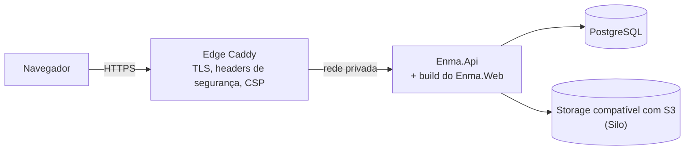

# ENMA

English version: [README.en.md](README.en.md)

SaaS multi-tenant de gestão para escritórios de advocacia brasileiros: clientes,
processos, prazos, tarefas, agenda, documentos e financeiro em um espaço de
trabalho por escritório.

**Status:** pre-release, em preparação para um piloto privado. A interface é em
português do Brasil.

[](https://github.com/JrCotrim/Enma/actions/workflows/ci.yml)
[](https://github.com/JrCotrim/Enma/actions/workflows/ci-heavy.yml)

## Screenshots

Todos os dados exibidos são fictícios, criados apenas para estas imagens.

| Visão geral | Processos |
| --- | --- |
|  |  |
| **Prazos** | **Agenda** |
|  |  |

## Funcionalidades

- **Organizações (tenants):** cadastro do Owner com verificação de e-mail; os dados de cada escritório ficam isolados.
- **Membros e papéis:** Owner, Administrator e Member, com desativação e troca de papel.
- **Convites:** convites por e-mail para entrar na organização, com reenvio e revogação.
- **Clientes:** pessoas físicas (CPF) e jurídicas (CNPJ), com desativação e reativação.
- **Processos:** número, vara ou órgão, status e membro responsável.
- **Prazos:** vencimentos por processo, com responsável, conclusão e reabertura.
- **Tarefas:** atribuídas a membros, opcionalmente vinculadas a um processo.
- **Agenda:** visão mensal de prazos, tarefas e eventos.
- **Documentos:** upload privado, preview no navegador e download, vinculados a um cliente ou processo.
- **Notificações in-app:** prazos e tarefas próximos do vencimento, eventos próximos e parcelas que vencem hoje.
- **Auditoria:** quem fez o quê, com o nome do membro que agiu.
- **Financeiro:** planos de pagamento parcelados, com baixa de pagamento e opção de desfazer.
- **Dashboard:** prazos e tarefas pendentes, próximos eventos e a posição financeira.
- **Transferência de propriedade:** o Owner transfere a organização para um Administrator.

## Arquitetura

Uma aplicação ASP.NET Core em camadas:

- `src/Enma.Domain` — entidades e regras de negócio, sem dependência de frameworks.
- `src/Enma.Application` — casos de uso, decisões de autorização e abstrações.
- `src/Enma.Infrastructure` — persistência com EF Core/PostgreSQL, e-mail e object storage.
- `src/Enma.Api` — endpoints Minimal API enxutos e composição.
- `src/Enma.Web` — single-page app em React + TypeScript, com build pelo Vite. Em produção a
  API serve o build na mesma origem, então o navegador só chama URLs relativas `/api/...`.

Os documentos ficam em um object storage privado compatível com S3 (Silo, uma
distribuição do MinIO); o banco de dados é PostgreSQL.



## Segurança e multi-tenancy

- **Isolamento entre tenants:** toda consulta a dados de um tenant é restrita à organização no
  servidor; um recurso de outro tenant responde o mesmo 404 neutro de um recurso inexistente, e
  testes negativos entre tenants cobrem isso.
- **Autorização com estado atual:** membership e papel são lidos do banco a cada request, sem
  confiar no cookie de sessão.
- **Sessões:** cookies com prefixo `__Host-` e tokens antiforgery nas requests que alteram estado.
- **Roles do banco com menor privilégio:** as migrations rodam com uma role de migração separada;
  a role da API tem apenas DML, e a tabela de auditoria é append-only (`SELECT`, `INSERT`).
  Os grants ficam em [`deploy/postgres/enma-roles.sql`](deploy/postgres/enma-roles.sql).
- **Auditoria na mesma transação** da alteração que ela registra.
- **Endurecimento do edge:** headers de segurança e uma Content Security Policy restritiva no Caddy.
- **Containers:** todas as capabilities do Linux removidas, exceto as poucas que cada serviço
  precisa, `no-new-privileges`, imagem da API sem root e imagens base fixadas por digest.
- **Rate limits** no login, no cadastro e no envio de convites por e-mail.
- **Backups:** criptografados com `age` e enviados para fora do servidor, para um bucket com
  retenção imutável (Object Lock).

## Stack

| Área | Tecnologia |
| --- | --- |
| Backend | .NET 10 (SDK 10.0.401), ASP.NET Core Minimal APIs |
| Persistência | EF Core 10, Npgsql, PostgreSQL 18.6 |
| Frontend | React 19, TypeScript 6, Vite 8, React Router 7 |
| Storage | Object storage compatível com S3 (Silo / cliente MinIO) |
| Edge e deploy | Docker, Docker Compose, Caddy 2.11 |
| Testes | xUnit, Testcontainers, Vitest, Testing Library, Playwright para .NET |
| CI | GitHub Actions |

As versões do toolchain são fixadas no [`Dockerfile`](Dockerfile) (Node.js 24.18.0, .NET SDK
10.0.401), e o CI as lê de lá.

## Como rodar

Ambiente de desenvolvimento no Windows com PowerShell.

Pré-requisitos:

- .NET SDK 10.0.401 ou um SDK 10.0 mais recente
- Node.js 24 (24.18.0 no CI)
- Docker Desktop
- Um certificado de desenvolvimento do ASP.NET Core confiável: `dotnet dev-certs https --trust`

1. Prepare o ambiente local. O script cria o `.env` a partir do `.env.example` quando ele não
   existe, sobe o PostgreSQL e o object storage privado com Docker Compose, cria as roles do
   banco, aplica as migrations do EF Core e grava as configurações da API nos User Secrets do
   .NET. Rode na primeira configuração e depois de baixar migrations novas:

   ```powershell
   powershell -NoProfile -ExecutionPolicy Bypass -File ".\scripts\setup-local.ps1"
   ```

2. Suba os serviços locais, incluindo o Mailpit para os e-mails enviados pela aplicação:

   ```powershell
   docker compose --env-file .env up -d
   ```

3. Inicie a API (HTTPS em `https://localhost:7028`):

   ```powershell
   dotnet run --project ".\src\Enma.Api\Enma.Api.csproj" --launch-profile https
   ```

4. Em outro terminal, inicie o app web:

   ```powershell
   cd src\Enma.Web
   npm ci
   npm run dev
   ```

Abra o app em <http://localhost:5173> (o Vite faz proxy de `/api` para a API) e leia os
e-mails de verificação e de convite no Mailpit em <http://localhost:8025>.
A API não aplica migrations na inicialização.

## Testes

```powershell
# Build e testes unitários
powershell -NoProfile -ExecutionPolicy Bypass -File ".\scripts\verify.ps1"

# Também os testes de integração (requer Docker)
powershell -NoProfile -ExecutionPolicy Bypass -File ".\scripts\verify.ps1" -IntegrationTests
```

Os testes de integração rodam contra containers reais de PostgreSQL, Mailpit e MinIO
iniciados pelo Testcontainers; eles não usam o `.env` nem os serviços de desenvolvimento.

Lint, type check e testes do frontend:

```powershell
cd src\Enma.Web
npm run lint
npm run typecheck
npm run test:run
```

As jornadas end-to-end no navegador (Playwright, Chromium) são opt-in e rodam sobre a stack
real em containers descartáveis:

```powershell
dotnet test tests/Enma.E2ETests
```

Elas precisam de um `npm run build` atualizado do app web e de uma instalação única do
Chromium; veja [`tests/Enma.E2ETests/README.md`](tests/Enma.E2ETests/README.md).

O CI roda build, testes unitários, checks do frontend e auditoria de dependências a cada push
([`ci.yml`](.github/workflows/ci.yml)), e as suítes de integração e E2E na `main`
([`ci-heavy.yml`](.github/workflows/ci-heavy.yml)).

## Deploy

O alvo é uma única VPS com Docker Compose: um edge Caddy na frente de uma réplica da API,
PostgreSQL e o object storage, com as migrations do banco executadas em um container
separado de execução única. Durante o piloto, a aplicação fica acessível apenas de forma
privada pelo Tailscale, e um backup diário criptografado é enviado para fora do servidor. Veja
o [runbook de produção](docs/operations/production-runbook.md), a
[topologia de produção](docs/deployment/production-topology.md), o
[guia de backup e restore](docs/operations/backup-restore.md) e o
[checklist de release beta](docs/deployment/beta-release-checklist.md).

## Status do projeto e roadmap

- Módulos principais prontos; em preparação para um primeiro piloto privado.
- Próximo: busca e classificação de documentos.
- Próximo: notificações externas (e-mail) para prazos e atribuições.

## Licença

Todos os direitos reservados.
